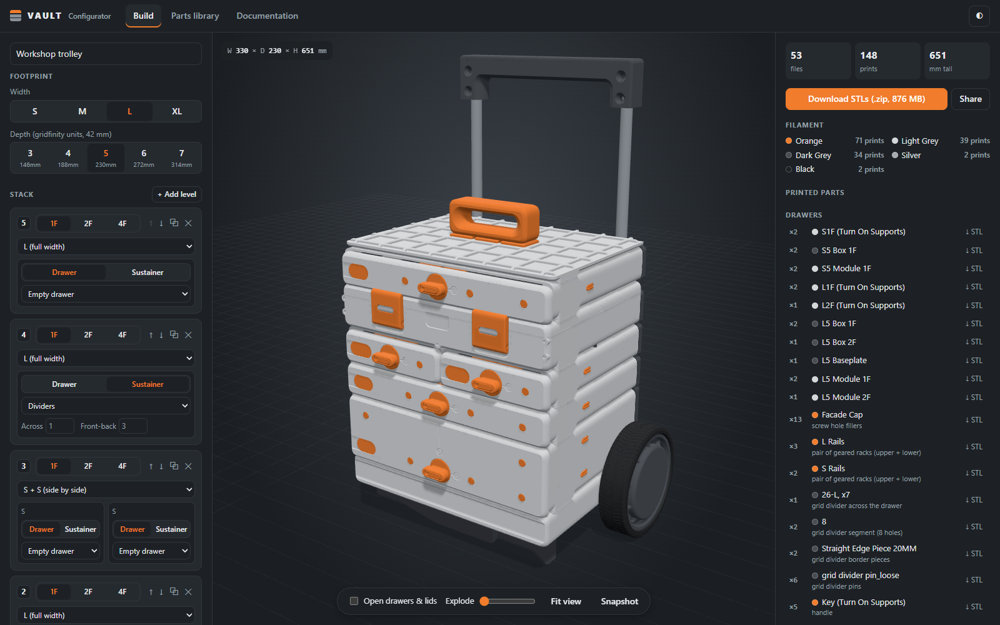
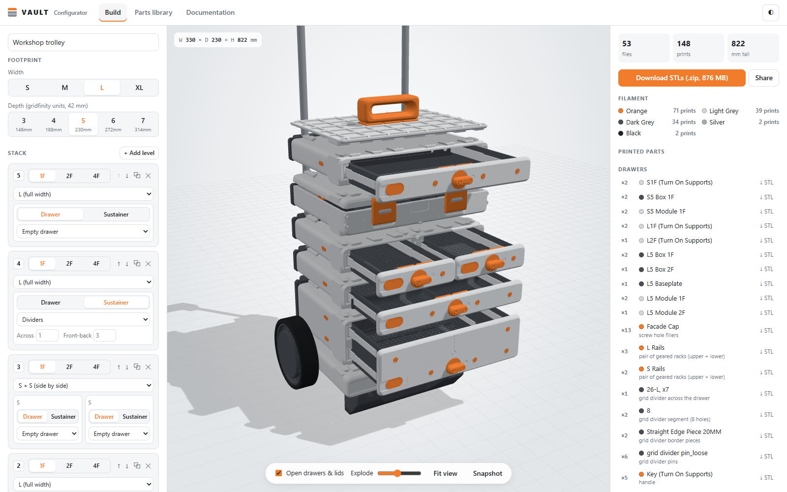
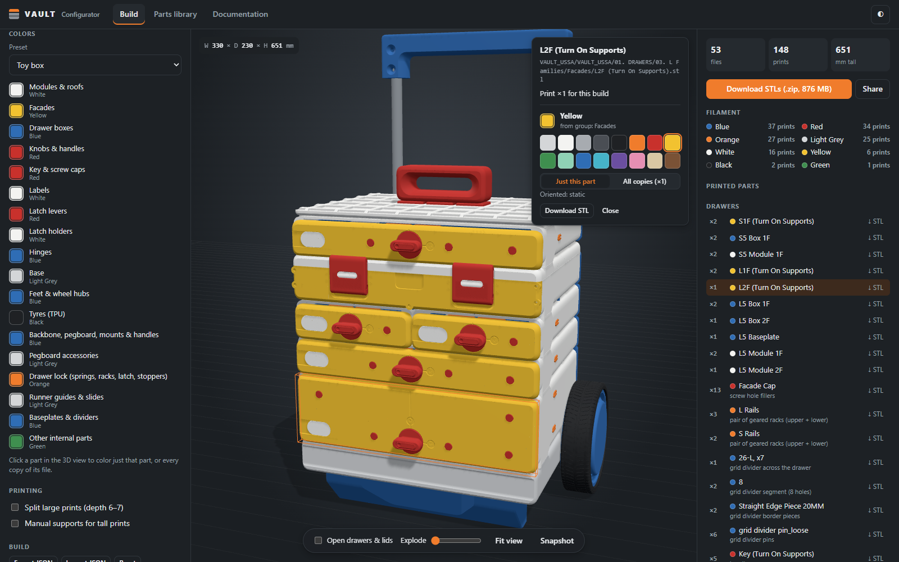
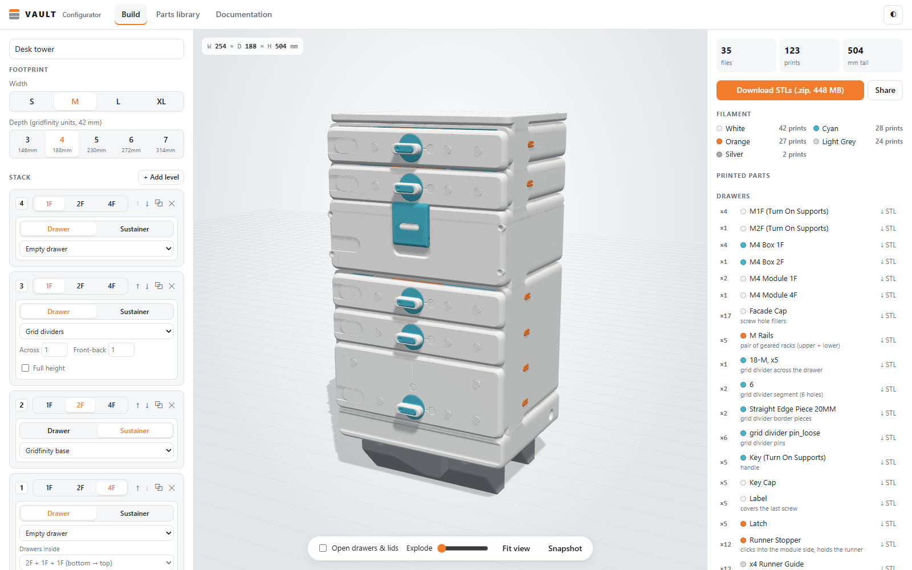
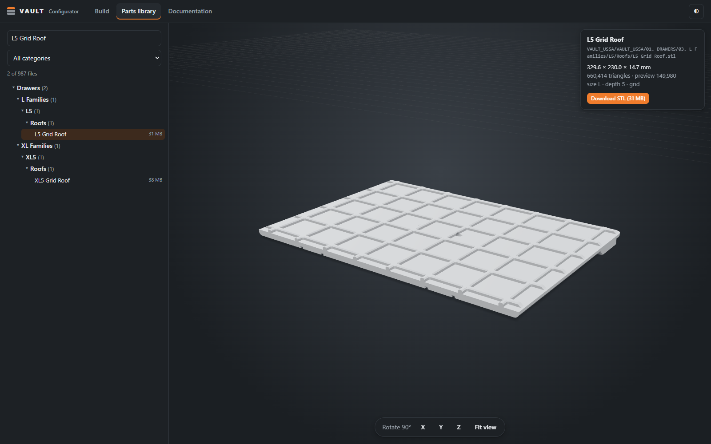

# VAULT Configurator

A self-hosted web app for planning VAULT modular storage builds:
pick a footprint, stack drawers and sustainers, add a roof, base, wheels, backbone, handles and
pegboards, see the assembled build in 3D, and download exactly the STL files (plus a hardware list)
you need to print it.



> [!IMPORTANT]
> **This repository does not include any VAULT files.** VAULT is a paid 3D-print design owned by
> its creator. To use this app you must already have your own copy of the VAULT STL files and
> documentation, **and a license to them** from the designer. The app only reads files you supply;
> it doesn't download, unlock or redistribute anything. Don't commit the data folder to a fork or
> host a public instance that serves files you aren't licensed to share. See
> [Data files (not included)](#data-files-not-included).
>
> This is an unofficial fan project, not affiliated with or endorsed by the VAULT designer.

**How to use it:** see the [user guide](docs/user-guide.md).

## Screenshots

| | |
| --- | --- |
|  |  |
| Open drawers & lids, and explode the parts to see how they fit | Colour presets, colour groups, and per-part colours from the 3D view |
|  |  |
| Any footprint and stack, e.g. a desk tower with three drawers in one 4F module | Browse, preview and download every file in your data folder |

The screenshots show renders of the VAULT parts as the app draws them, from the designer's STL
files (not included here).

## Data files (not included)

You need:

1. **The VAULT files**: the STL set plus the documentation PDFs, as you received them from the
   designer (about 26 GB unzipped).
2. **A license that covers your use.** A personal license covers running this app for yourself.
   Check your license terms before you share an instance with anyone else, because the app serves
   the original STLs for download.

Put the files in a folder named `Data` next to the app, or anywhere else and pass `-data /path`.
The folder is git-ignored. The app scans it recursively at start-up and works out what each
file is from its folder and file names, so **keep the original folder and file names**. Renamed
or moved files won't be recognised, or will be put in the wrong place. The app only reads the
folder; it never changes it.

Expected layout (the top folder name, here `VAULT_USSA`, can be anything; the numbered category
folders are what the scanner looks for):

```
Data/
└── VAULT_USSA/
    ├── 01. DRAWERS/
    │   ├── 01. S Families/
    │   │   ├── Facades/                     S1F / S2F / S4F facades
    │   │   ├── S3/ … S7/                    one folder per depth
    │   │   │   ├── Boxes/                   S4 Box 1F.stl, 2F, 4F
    │   │   │   ├── Gridfinity Baseplate/    S4 Baseplate*.stl
    │   │   │   ├── Modules/                 S4 Module 1F.stl, 2F, 4F
    │   │   │   └── Roofs/                   Grid, Table, Bowl, Under Table Mount
    │   ├── 02. M Families/                  same layout as S (M3 … M7)
    │   ├── 03. L Families/                  same layout as S (L3 … L7)
    │   ├── 04. L² Families/
    │   │   └── L3² … L7²/                   L4² Module 1F.stl, 2F, 4F
    │   ├── 05. XL Families/                 same layout as S (XL3 … XL7)
    │   ├── 06. XL² Families/
    │   │   └── XL3² … XL7²/
    │   └── 07. Universal/
    │       ├── Geared Rails/
    │       ├── Grid Dividers/               20MM TALL, 34.5MM TALL…, 82.5MM TALL…, 01. INSTRUCTIONS
    │       ├── L² Accessories/
    │       ├── Manual Supports/
    │       ├── Runners/                     (+ XL Runners/)
    │       └── …                            keys, caps, label, springs, latch, top handle
    ├── 02. SUSTAINERS/
    │   ├── 01. S Families/ … 04. XL Families/
    │   │   ├── Facades/
    │   │   └── S3/ … S7/                    Modules/ and Roof/ or Roofs/
    │   └── 05. Universal/
    │       ├── Baseplates/                  01. S, 02. M, 03. L, 04. XL
    │       ├── Dividers/                    S, M, L Width/Depth/Seal, XL Depth
    │       ├── Facades/
    │       ├── Hinges/
    │       ├── Locks/
    │       └── Rods/
    ├── 03. MODIFICATIONS/
    │   ├── Backbone/
    │   ├── Base/                            S, M, L, XL
    │   ├── Feet/
    │   ├── Pegboard Attachment/             IKEA Skadis Pegboard, USSA Pegboard
    │   ├── Pull-out Handle/
    │   ├── Stationary Handle/
    │   ├── Wall Mounts/
    │   └── Wheels/
    ├── 04. PEGBOARD/
    │   ├── CONTAINERS/                      2_Depth_50mm … 5_Depth_125mm / Width_2 … 10 inches,
    │   │                                    HOOKs for containers
    │   └── HOOKS/                           20mm … 100mm
    └── 05. Documentation/                   the manuals (PDF) and reference images
```

Files the app doesn't recognise still appear in the **Parts library** tab, under *Other*.

## Running

Requires Go 1.24+ and the data folder described above.

```bash
go run . -data Data
```

Open <http://localhost:8080>.

Build a single self-contained binary (the web front end is embedded):

```bash
go build -o vault-configurator .
./vault-configurator -data /path/to/Data -addr :8080
```

Cross-compile for a NAS / Raspberry Pi / Windows box, for example:

```bash
GOOS=linux GOARCH=arm64 go build -o vault-configurator-linux-arm64 .
```

Or with Docker (data mounted read-only, preview cache in a volume):

```bash
docker build -t vault-configurator .
docker run -p 8080:8080 -v "$PWD/Data:/data:ro" -v vault-cache:/cache vault-configurator
```

The first time a large part is shown, the app prepares a lightweight 3D preview of it, which can
take a few seconds; after that it loads instantly. Use `-warm` to prepare every preview in the
background at start-up.

### Flags

| Flag        | Default | Purpose                                                                 |
| ----------- | ------- | ----------------------------------------------------------------------- |
| `-data`     | `Data`  | Folder with the VAULT files (scanned recursively at start-up)           |
| `-addr`     | `:8080` | Listen address                                                          |
| `-cache`    | `cache` | Where generated preview meshes are stored                               |
| `-warm`     | `false` | Pre-generate every preview in the background at start-up                |
| `-workers`  | ½ CPUs  | Concurrent preview generators (each can use a few hundred MB on big files) |
| `-max-tris` | 150000  | Triangle budget per preview mesh                                        |

## Limitations

- Quantities for small universal parts (runners, locks, hinges, dividers) are best-effort readings
  of the manuals. Check them against the manuals in the Documentation tab before printing.
- The 3D view is a guide, not CAD: parts are placed from the manuals and measurements of the files,
  so small internal parts can be a few mm off. The parts list is what matters for printing.

## Development

Architecture, design decisions, the API and the notes behind how each part is placed are in
[docs/development.md](docs/development.md).

## License

The code in this repository is released under the [MIT License](LICENSE). three.js in `web/vendor/three` is MIT licensed
(see its `LICENSE`). The VAULT design, its STL files, manuals and images belong to their creator,
aren't covered by this repository, and need their own license.
