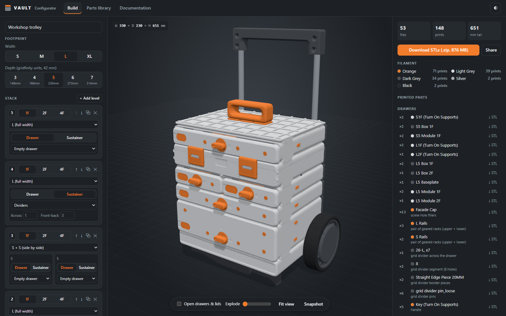
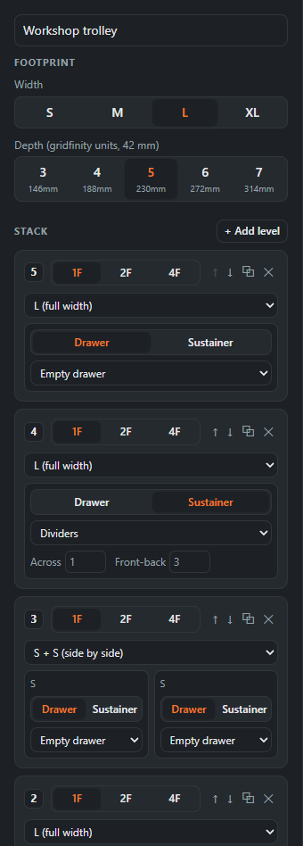
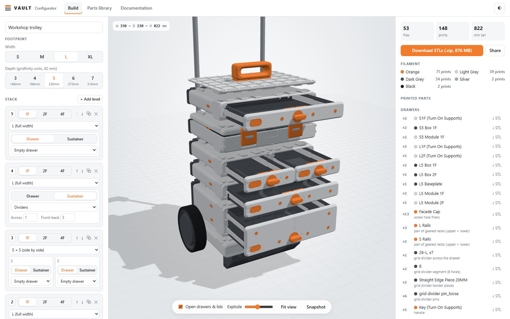
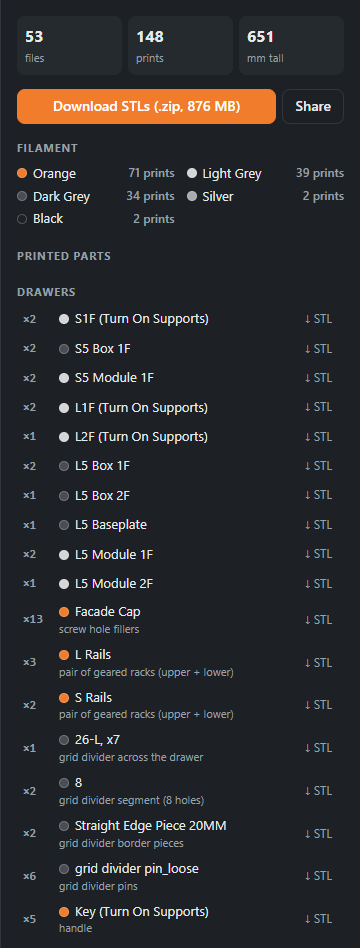
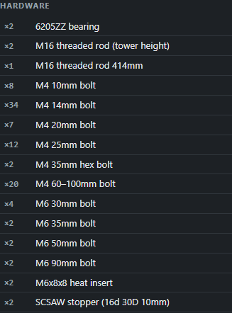
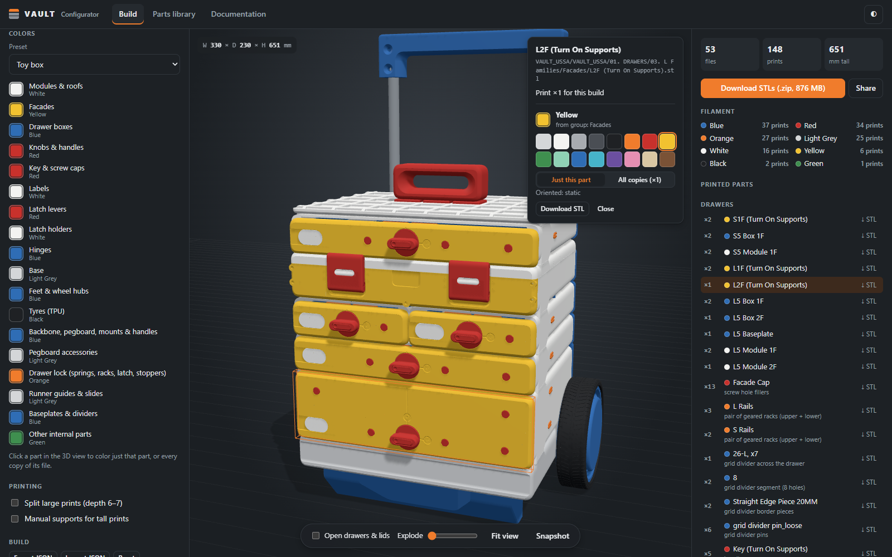
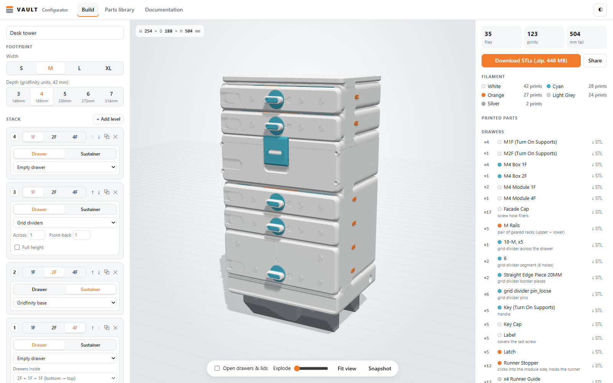
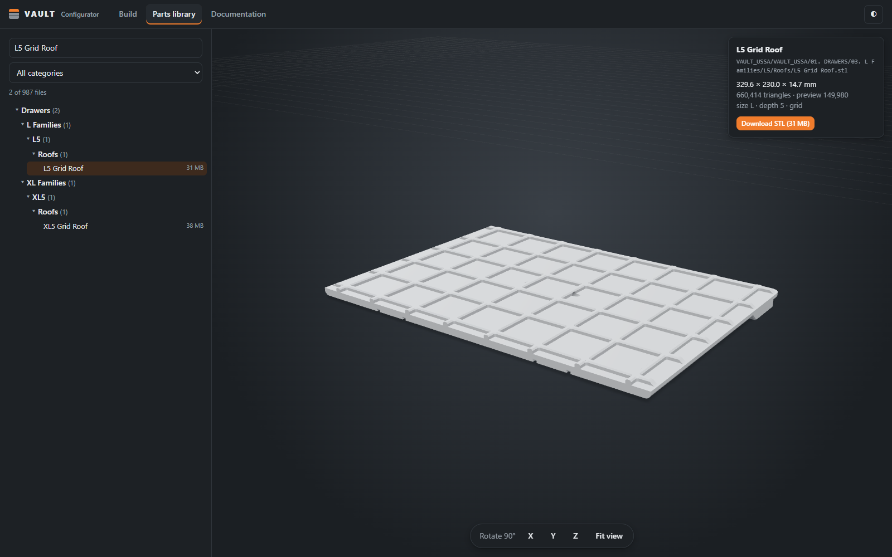

# VAULT Configurator user guide

The configurator helps you plan a VAULT storage build, see it in 3D, and download exactly the STL
files and hardware you need to print and assemble it. It reads your own copy of the VAULT files
(see [Data files](../README.md#data-files-not-included) in the README); nothing is downloaded from
the internet.

- [Getting started](#getting-started)
- [The Build tab](#the-build-tab)
  - [Build options (left panel)](#build-options-left-panel)
  - [3D view](#3d-view)
  - [Parts list and downloads (right panel)](#parts-list-and-downloads-right-panel)
- [Colours](#colours)
- [Saving and sharing builds](#saving-and-sharing-builds)
- [The Parts library tab](#the-parts-library-tab)
- [The Documentation tab](#the-documentation-tab)
- [Tips and limits](#tips-and-limits)

## Getting started

1. Start the app with your data folder: `go run . -data Data` (or the built binary, see the
   README's [Running](../README.md#running) section).
2. Open <http://localhost:8080>. The **Build** tab opens with an example build.
3. Change the build on the left, check it in the 3D view, then use **Download STLs** on the
   right to get a ZIP of everything to print.

The first time a large part is shown, the server prepares a lightweight preview of it, which can take
a few seconds; after that it loads instantly.

## The Build tab

The Build tab has three columns: **build options** on the left, the **3D view** in the middle, and
the **parts list** on the right. Every change updates the view and the list straight away.

### Build options (left panel)

**Name.** The name at the top is used for the ZIP and snapshot file names.

**Footprint.** Choose the **width** (S 165 mm, M 254 mm, L 330 mm, XL 419 mm) and the **depth**
in gridfinity units (3–7, from 146 mm to 314 mm). Every level in the stack shares this footprint.

**Stack.** The stack is shown top level first, like the real tower. Use **+ Add level** to add a
copy of the top level. For each level you can set:

- **Height:** 1F, 2F or 4F. Heights that don't exist for the current size or type are greyed out.
- **Layout** (L and XL only): one full-width module, an **L²/XL²** module (two drawers side by
  side in one module, drawers only), or two narrower modules side by side (**S + S** for L;
  **S + M** or **M + S** for XL).
- **Drawer or Sustainer** for each module. Drawers slide out; sustainers are boxes with a hinged,
  latched lid.
- **Interior:**
  - Drawers: empty, grid dividers, or a gridfinity baseplate (plain, or with one or two handles).
  - Sustainers: flat, gridfinity base, dividers, or sealed (L/XL only).
  - Dividers have their own counts: across, front-back, full height, or sealed rows.
- **Drawers inside** (2F/4F drawers): a tall module can hold a stack of smaller drawers instead of
  one tall one, for example 2F + 1F + 1F. In L²/XL² modules the left and right sides each get their
  own drawers and interior.
- **Level tools:** move the level up (↑) or down (↓), duplicate it (⧉) or remove it (✕).

**Roof.** If the top level is a drawer, pick the roof: gridfinity, table, bowl, heavyweight (L/XL),
heavyweight cut (XL), under-table mount, or none. The gridfinity and heavyweight roofs can take the
**top carry handle**. A sustainer on top uses its own lid instead.

**Drawers.** Choose the drawer **handle**: a knob, or a flush **hidden key**, with one removable key
per build. Builds with grid dividers also choose loose or tight divider pins, and straight or
rounded border pieces.

**Base.** Choose no base, **base + feet** (stationary), **base + wheels** (mobile, with one foot at
the front), or **base + casters**.

**Back & mounting.**

- **Backbone:** boards across the back that reinforce and connect the modules.
- **Pull-out handle:** a trolley handle on two M16 rods. A handle lock takes the place of the top
  backbone board.
- **Stationary handle:** a fixed handle bolted to a backbone board.
- **Backbone boards:** full width, or universal (narrow boards at each side).
- **Module connectors:** pieces that tie stacked modules together at the back.
- **Wall mounts:** for hanging the stack on a wall.
- **Pegboard attachment:** IKEA Skådis or USSA pegboard plates on the backbone.

Handles and pegboards need the backbone, so it is added automatically when you pick them.

**Accessories & extras.** Add pegboard hooks, containers, container hooks, holders, or extra grid
divider pieces, with a quantity for each. They are listed separately and shown on a shelf beside the
build.

**Colors.** See [Colours](#colours) below.

**Printing.**

- **Split large prints:** uses the Part 1 / Part 2 files where they exist, for depths 6–7 that
  don't fit smaller printers.
- **Manual supports:** adds the print-aid files for tall modules.

**Build.** **Export JSON**, **Import JSON** and **Reset** (see
[Saving and sharing builds](#saving-and-sharing-builds)).

 

### 3D view

- **Rotate:** drag with the left mouse button. **Pan:** drag with the right button. **Zoom:**
  scroll.
- **Open drawers & lids** slides the drawers out and opens the sustainer lids. **Explode** pulls the
  levels and parts apart so you can see how they fit together.
- **Fit view** brings the whole build back into view. **Snapshot** saves the current view as a PNG.
- The overall size of the build (width × depth × height in mm) is shown in the top-left corner.
- **Click a part** to open its card: the file name and path, how many to print for this build, its
  colour, a **Download STL** link, and how the part was oriented in the preview.
- Hover a row in the parts list to highlight that part in 3D.
- The **◐** button in the top-right switches between light and dark themes.

### Parts list and downloads (right panel)

- **Totals:** the number of different files, the total number of prints, and the build height.
- **Warnings:** shown when an option was adjusted, for example backbone parts added for a handle,
  or a combination to check against the manual.
- **Download STLs (.zip)** downloads every file the build needs. Inside the ZIP, files are grouped
  in one folder per filament colour, keep the original VAULT folder structure, and are named with
  the print count, for example `My VAULT/Orange/…/Key Cap (print x2).stl`.
- **Share** copies a link to this build (see below).
- **Filament** shows how many prints you need in each colour.
- **Printed parts** are grouped by section (drawers, sustainers, roof, base, backbone and handles,
  and so on). Each row shows the quantity, the colour(s), a short note on what the part is for, and
  a **↓ STL** link for that one file. A file printed in two colours is split, for example
  "2 × Orange, 1 × Green".
- **Print aids** (manual supports, the wheel bushing jig) are listed but never drawn.

 

**Hardware** lists the bolts, threaded rods, bearings, heat inserts and stoppers to buy, with
quantities. The rod lengths match your width; the pull-out handle rods are cut to the height of
your tower.

Quantities for small universal parts are taken from the manuals as well as possible. Check them
against the Documentation tab before printing.

 

## Colours

- **Preset:** start from Classic, Orange accents, Stealth, Arctic or Toy box.
- **Colour groups:** every kind of part belongs to a group, such as modules & roofs, facades, drawer
  boxes, knobs & handles, latches, hinges, base, feet & wheel hubs, tyres, backbone, or internal
  parts. Click a group's swatch to change it, and **↺** to go back to the preset colour.
- **Single parts:** click a part in the 3D view, then choose **Just this part** or **All copies**
  (every copy of that file) and pick a colour. **↺ Use group color** removes the override.

The colours drive the filament summary and the folders in the ZIP download, and they are saved with
the build and in share links.

## Saving and sharing builds

- **Autosave:** your current build is saved in the browser automatically and comes back next time
  you open the app.
- **Share:** copies a link with the whole build (layout, options and colours) encoded in it.
  Opening the link loads that build.
- **Export JSON / Import JSON:** saves the build as a file and loads it again, for backups or for
  keeping several builds.
- **Reset:** goes back to the example build.

*A different build: an M-width desk tower on feet, with a 4F module holding three drawers
(2F + 1F + 1F), a 2F sustainer with a gridfinity base, a grid-divider drawer and a table roof, in
the Arctic preset.*

## The Parts library tab

The Parts library lists every file in your data folder, in the original folder structure.

- **Search** by name, for example `L5 2F`, `hinge` or `roof`. You can also narrow the list to one
  category.
- **Click a file** to preview it in 3D. The card shows its size in mm, its triangle count, the size,
  depth and height tags the app read from its name, and a **Download STL** button.
- **Rotate 90°** around X, Y or Z, and **Fit view**, to inspect a part from any side.

Files the app doesn't recognise still appear here, under *Other*.

## The Documentation tab

The Documentation tab lists the manuals (PDF), the reference images and any notes from your data
folder. Click one to open it in a new browser tab. The VAULT manuals are the reference for assembly,
print settings and hardware.

## Tips and limits

- **First previews are slow.** The first view of a large part takes a few seconds while its preview
  is generated. Start the server with `-warm` to prepare every preview in the background.
- **The 3D view is a guide, not CAD.** Parts are placed from the manuals and from measurements of
  the files, so small internal parts (springs, pins, runners) can be a few mm off. The parts list
  is what matters for printing.
- **Keep the data folder as it is.** The app recognises files by their original folder and file
  names, and it never changes them. If you rename or move files, they will be missed or listed
  under *Other*.
- **Licensing.** The configurator only reads the VAULT files you supply. Don't share an instance or
  the downloaded files with anyone your VAULT licence doesn't cover.
